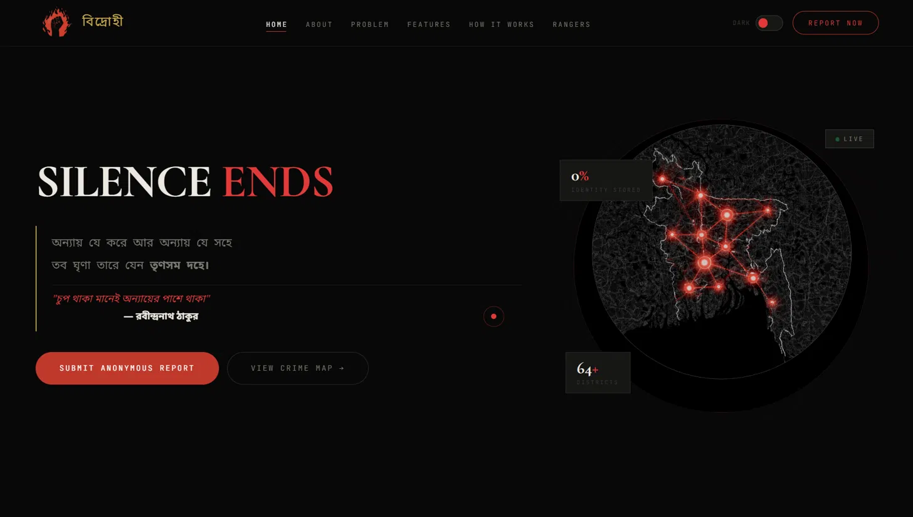
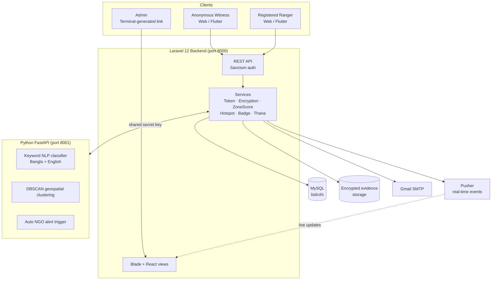
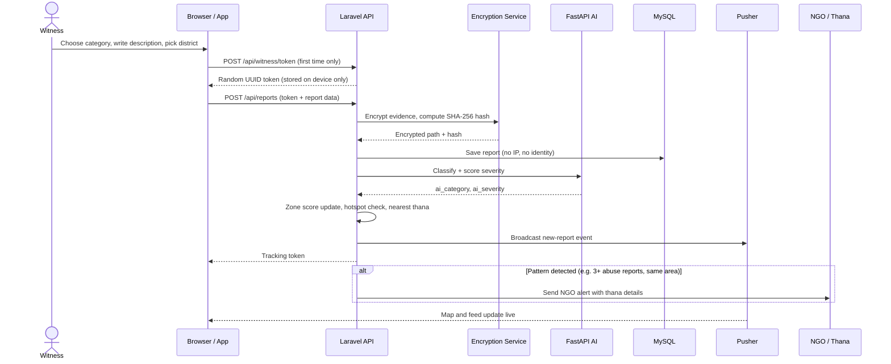
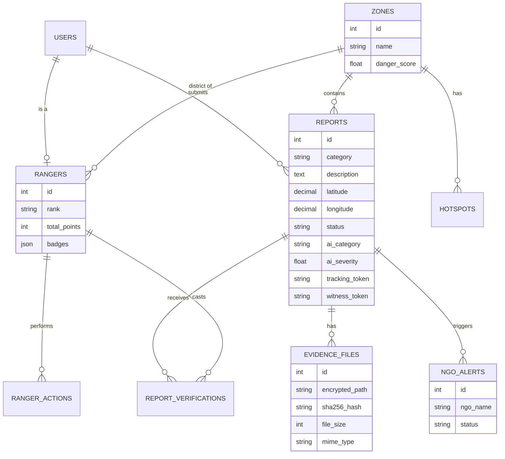
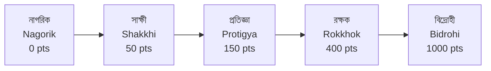

# BIDROHI (বিদ্রোহী)

**Not violence. Not protest. Evidence.**



<!-- DEMO VIDEO: paste your video link or thumbnail here. See the steps I gave you. -->

BIDROHI is an anonymous crime and corruption reporting platform built for Bangladesh. A citizen can report bribery, corruption, child abuse or harassment without giving a name, an email or a phone number, and without the server ever storing their IP address. Reports are classified by an AI service, plotted on a live map of all 64 districts, and, when a pattern shows up, flagged to NGOs and matched to the nearest police thana.


---

## Why this exists

Bangladesh has no central place where an ordinary person can report something they witnessed and stay safe while doing it. People who see a bribe being taken, or signs of child abuse in their neighbourhood, usually stay quiet because speaking up has a personal cost. Existing platforms like *I Paid A Bribe* (India) or *Ushahidi* (Kenya) weren't built for Bangla, local NGOs, or Bangladeshi geography.

BIDROHI is built around one rule: **the system should be unable to identify the reporter, even if someone forces it to.** That shapes most of the technical decisions below.

---

## What it does

- **Anonymous reporting.** No account needed. The browser or app holds a random UUID token, and that token is the only "identity" the system knows.
- **Encrypted evidence.** Uploaded files are encrypted with AES-256-CBC before they touch disk. A SHA-256 hash of the original file is stored so tampering can be detected later.
- **AI analysis.** A separate Python service classifies each report (Bangla and English), scores severity, and clusters reports geographically to find hotspots.
- **Live intelligence map.** All 64 districts are coloured by danger score, with hotspot markers, filters and a live stats bar.
- **Public intel feed.** A scrollable, privacy-safe feed of reports. Coordinates are rounded to about 1 km and no identity is ever shown.
- **NGO alerts.** When the AI sees a pattern, such as repeated child-abuse reports from one area, an alert goes out automatically.
- **Thana alerts.** Each report is matched to the nearest police station using the Haversine distance formula.
- **Ranger network.** Registered users earn points and climb five Bangla ranks. Districts compete on a leaderboard.
- **Admin panel.** No login page exists. The admin generates a one-time link from the terminal.

---

## System architecture



The Python service is never exposed to the internet. Only Laravel can call it, and every call carries a shared secret.

---

## What happens when someone submits a report



---

## Database

Database name: `bidrohi`



Supporting tables: `admin_login_tokens`, `sessions`, `cache`, `personal_access_tokens`.

---

## Rangers

Anyone can report anonymously. Registering as a Ranger is optional and adds points, ranks and a district leaderboard. A Ranger needs a username, an email (for verification only, never shown publicly) and a password.



| Action | Points |
|---|---|
| Submit a report | +10 |
| Verify someone else's report | +15 |
| Your report gets confirmed by 3 Rangers | +25 |
| Your report leads to NGO action | +100 |

---

## Tech stack

| Layer | Technology |
|---|---|
| Backend | Laravel 12 (PHP) |
| Database | MySQL |
| Web frontend | React.js, Tailwind CSS v4 (via `@tailwindcss/vite`, no config file) |
| Mobile | Flutter |
| AI service | Python FastAPI, scikit-learn |
| Real-time | Pusher |
| Map | Leaflet.js with CartoDB dark tiles (no API key) |
| Auth | Laravel Sanctum |
| Email | Gmail SMTP |

---

## Security and privacy decisions

| Decision | Why |
|---|---|
| No IP logging, no identity storage | The system can't leak what it never had |
| UUID witness token held on the device | Lets people track their own report without an account |
| AES-256-CBC evidence encryption | Files are unreadable if storage is ever accessed directly |
| SHA-256 hash of the original file | Evidence tampering becomes detectable |
| Public coordinates rounded to ~1 km | The feed can't pinpoint a house |
| Admin access by one-time link only | There is no admin login page to attack. Links expire in 15 minutes |
| Python service behind Laravel with a shared secret | The AI service is never publicly reachable |
| Rate limiting on report submission | Reduces spam from fake reports |

---

## Routes

### Web

| Route | Page |
|---|---|
| `/` | Landing page |
| `/report` | Submit an anonymous report |
| `/status` | Track a report with its token |
| `/feed` | Public intel feed |
| `/dashboard` | Intelligence map |
| `/leaderboard` | District and Ranger rankings |
| `/ranger/login`, `/ranger/register` | Ranger authentication |
| `/ranger/profile` | Ranger profile, rank and badges |
| `/admin/auth/{token}` | One-time admin login |
| `/admin` | Admin panel (needs a session, otherwise redirects to `/`) |

### API

```
POST   /api/witness/token                 Generate anonymous token
POST   /api/witness/status                Check report status
POST   /api/ranger/register               Register (sends verification email)
GET    /api/ranger/verify/{token}         Verify email
POST   /api/ranger/resend-verification
POST   /api/ranger/login
POST   /api/ranger/logout
GET    /api/ranger/me
POST   /api/reports                       Submit report (anonymous or Ranger)
GET    /api/reports                       List reports (admin)
GET    /api/reports/{id}                  Report detail (admin)
PATCH  /api/reports/{id}/status           Update status (admin)
GET    /api/zones                         All 64 districts
GET    /api/zones/heatmap                 Map data
GET    /api/zones/{id}                    Zone detail
GET    /api/stats                         Live platform counters
GET    /api/feed                          Public paginated feed
GET    /api/leaderboard                   Global top 50
GET    /api/leaderboard/zones             Zone control
GET    /api/leaderboard/ranks             Rank distribution
GET    /api/leaderboard/district/{name}   District leaderboard
GET    /api/rangers/{username}            Public Ranger profile
GET    /api/rangers/me/stats
GET    /api/rangers/me/actions
PATCH  /api/rangers/me/district
```

---

## Project structure

```
bidrohi/
├── app/
│   ├── Http/Controllers/        API + admin controllers
│   ├── Models/                  Report, Zone, Ranger, EvidenceFile, ...
│   ├── Services/                AnonymousToken, EvidenceEncryption, ZoneScore,
│   │                            HotspotDetection, Badge, AiAnalysis, ThanaAlert
│   └── Events/                  NewReportSubmitted (Pusher broadcast)
├── ai-service/                  Python FastAPI microservice
├── database/migrations/
├── resources/
│   ├── js/                      React dashboard, StatsBar, NewsFeed, hooks
│   └── views/                   Landing, report, feed, status, ranger, admin
├── routes/                      web.php, api.php
└── README.md

bidrohi_mobile/                  Flutter app (separate repository)
```

---

## Running it locally

**You need:** PHP 8.2+, Composer, Node.js, Python 3.10+, XAMPP (MySQL only).

```bash
# 1. Start MySQL from the XAMPP control panel (Apache stays off)

# 2. Backend
git clone https://github.com/Tamima-Hossen-Samantha/bidrohi.git
cd bidrohi
composer install
npm install --legacy-peer-deps
cp .env.example .env
php artisan key:generate
```

Create an empty database called `bidrohi` in phpMyAdmin, then fill in the DB, Gmail SMTP, Pusher and AI-service secret values in `.env`.

```bash
php artisan migrate --seed          # creates tables and seeds all 64 districts
php artisan admin:create            # create the admin account (first time only)

# 3. Run everything (three terminals)
php artisan serve --host=0.0.0.0 --port=8000
npm run dev
cd ai-service && python -m uvicorn main:app --host 127.0.0.1 --port 8001 --reload
```

Open `http://127.0.0.1:8000`.

**Admin access.** There is no login page. Generate a link in the terminal:

```bash
php artisan admin:link
```

It prints a URL like `http://127.0.0.1:8000/admin/auth/{64-char-token}`. The link works once and expires after 15 minutes.

**Flutter.** Put your laptop's WiFi IP (from `ipconfig`) into the app's `baseUrl`, make sure the phone and laptop are on the same network, and add `android:usesCleartextTraffic="true"` to `AndroidManifest.xml` for local testing.

---

## Current status

| Area | Status |
|---|---|
| Laravel backend, migrations, models | Done |
| Anonymous token system, AES-256 encryption | Done |
| 64 districts seeded, zone scoring, hotspot detection | Done |
| Ranger system: points, ranks, badges, leaderboard | Done |
| Email verification (Gmail SMTP) | Done |
| Python AI service (keyword classifier + DBSCAN) | Done |
| Landing page | Done |
| Intelligence map dashboard | Done |
| Admin panel (reports, zones, evidence) | Done |
| Stats API, public feed API | Written, being integrated |
| SHA-256 evidence hashing | Written, being integrated |
| Admin NGO alerts and Rangers pages | Written, being integrated |
| Web report form, status page, Ranger pages | Written, report submission being debugged |
| Thana alert service | Written, being integrated |
| Pusher real-time updates | Written, needs credentials and wiring |
| Flutter app | Screens written, connection to API in progress |

### Known limitations

- The AI classifier is **keyword-based** (Bangla and English). It does not use a trained model, so it can misclassify jokes or unusual phrasing. A confidence threshold before triggering NGO alerts is planned.
- Anonymous reporting means spam is possible. Rate limiting helps, but a stronger anti-abuse layer is still needed.
- The scheduled AI clustering job and the internal NGO alert callback route are not finished.
- Not deployed yet. Everything runs locally.

---


## License

This project is released under the MIT License — see the [LICENSE](LICENSE) file for the full text.

You are free to use, copy, modify, and distribute the firmware, including for commercial purposes, as long as the original copyright notice is kept. The software is provided "as is" without warranty.